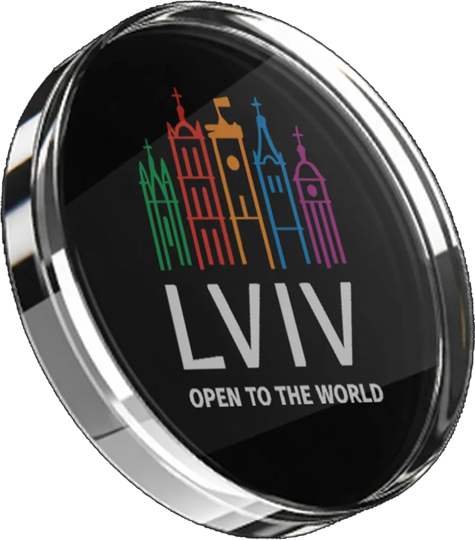
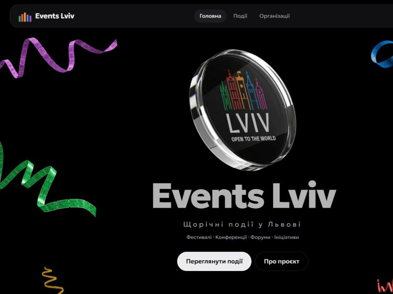
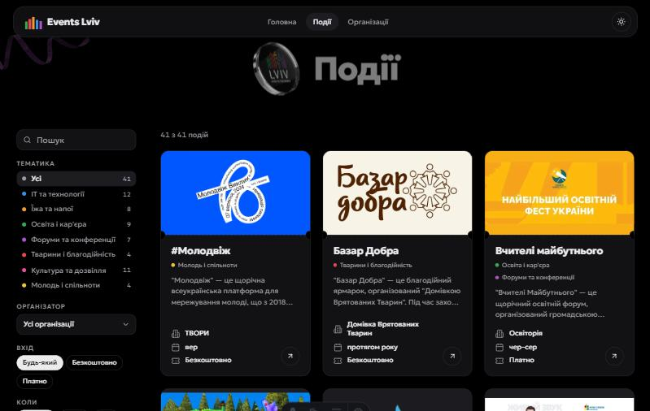

<div align="center">



# Events Lviv

**Щорічні події у Львові в одному місці**<br>
Фестивалі · конференції · форуми · ініціативи


</div>

<table>
  <tr>
    <td></td>
    <td></td>
  </tr>
</table>

## Що це

Список щорічних подій Львова для тих, хто хоче знати, що відбувається в місті протягом року. Кожна подія розписана за однаковим шаблоном: опис, для кого, де, коли, умови входу, посилання й фотографії. Події однієї організації зібрані на її сторінці.

Проєкт волонтерський і розвивається нерегулярно. Нову подію чи виправлення можна запропонувати автору в [Instagram](https://www.instagram.com/the_deiw_/).

## Що вміє сайт

- **Список подій** (`/events/`) з фільтрами, які діють разом: пошук за назвою чи організатором, тематика, організатор, вхід (безкоштовно / платно), пора року.
- **Сторінка кожної події** (`/events/<id>/`) і **сторінки організацій** (`/organizations/<id>/`) з описом та їхніми подіями.
- **Головна** з героєм і текстом про проєкт.
- **Дві мови:** українська (`/`) і англійська (`/en/`). Перемикач «UA / EN» у шапці веде на ту саму сторінку іншою мовою.
- **Світла й темна тема** без блимання при завантаженні, вибір пам'ятається.
- **Картки-квитки** в кольорах п'яти шпилів львівського логотипа. Обкладинки показуються повністю, без обрізання й розмиття: поля беруться з кольору самої картинки, прозорі логотипи стоять на світлій або темній плитці.
- **Без клієнтського фреймворку.** Усі сторінки збираються в статичний HTML, JavaScript потрібен лише для фільтрів і перемикача теми.
- Паралакс у героєві працює на CSS (`animation-timeline: scroll()`), а при `prefers-reduced-motion` вимикається.

## Швидкий старт

Потрібен [Node.js](https://nodejs.org) 22.22 або новіший.

```bash
npm install
npm run dev
```

Сайт відкриється на <http://localhost:4321>.

| Команда | Що робить |
|---|---|
| `npm run dev` | локальний сервер із живим перезавантаженням |
| `npm run build` | збирає статичний сайт у `dist/` |
| `npm run preview` | показує зібраний `dist/` |
| `npm run covers` | перераховує кольори полів навколо обкладинок (після додавання чи заміни картинок) |

## Дані

Усе, що бачить відвідувач, лежить у `data/`. Це **джерело правди**: список колись був імпортований з Notion, тепер його редагують тут.

| Файл | Вміст |
|---|---|
| `data/events.json` | події |
| `data/organizations.json` | організації (опис, посилання, логотип, простори) |
| `data/topics.json` | тематики та їхні кольори |
| `data/cover-bg.json` | кольори полів навколо обкладинок, генерується `npm run covers` |
| `data/en/events.json`, `organizations.json`, `topics.json` | англійський переклад: лише перекладені поля за тим самим `id`, решта береться з українських файлів |

### Як додати подію

1. Додайте картинки в `public/images/<id-події>/` (обкладинка `cover.webp`, фото `1.webp`, `2.webp`…).
2. Додайте запис у `data/events.json`:

```jsonc
{
  "id": "molodvizh",                  // стає адресою /events/molodvizh/
  "name": "#Молодвіж",
  "organizationId": "tvory",          // id з organizations.json, або без поля
  "topics": ["youth"],                // it, food, education, forums, charity, culture, youth
  "description": ["Абзац опису…"],
  "audience": "Для кого",
  "place": "Де проходить",
  "whenText": "Щорічно, перша субота вересня.",
  "months": [9],                      // 1–12, потрібні лише для фільтра «пора року»
  "yearRound": false,                 // true: подія триває цілий рік
  "entry": "free",                    // free | paid | mixed
  "priceText": "Участь безкоштовна",
  "links": [{ "title": "Instagram", "url": "https://…", "type": "instagram" }],
  "cover": "images/molodvizh/cover.webp",
  "gallery": ["images/molodvizh/1.webp"]
}
```

3. Запустіть `npm run covers`, щоб порахувати колір полів для нової обкладинки. Для однієї події його можна задати вручну: `"coverBg": "#ffcc00"`.
4. Додайте переклад у `data/en/events.json` під тим самим `id`: `name` (лише якщо назву треба перекласти чи транслітерувати), `description`, `audience`, `place`, `whenText`, `priceText` і `links` (список перекладених назв посилань у тому ж порядку). Без цього англійська сторінка покаже українські тексти цієї події.

## Структура

```
data/          події, організації, тематики; data/en/ їхній англійський переклад
design/        DESIGN.md (рішення щодо дизайну), вихідні картинки, порівняння обкладинок
docs/          скриншоти для цього README
public/        favicon, hero-стрічки, картинки подій і організацій
scripts/       cover-colors.mjs: кольори полів навколо обкладинок
src/
  components/  EventCard, Filters, MiniHero
  i18n/ui.ts   увесь текст інтерфейсу українською й англійською
  layouts/     Base: шапка, перемикач мови, футер, тема
  lib/site.ts  дані потрібною мовою, посилання з урахуванням base і мови, хелпери
  pages/       маршрути: тонкі файли, українські в корені, англійські в en/
  views/       сторінки (Home, Events, Event, Orgs, Org), спільні для обох мов
  scripts/     filter.ts: логіка фільтрів
  styles/      global.css: змінні тем і спільні стилі
```

Дизайн-рішення (палітра, картка, шапка, hero, обкладинки) описані в [`design/DESIGN.md`](design/DESIGN.md).

## Мови

Українська основна й лежить у корені (`/events/`), англійська під `/en/` (`/en/events/`). Мову визначає адреса, тож кожна сторінка має власне посилання, яке можна індексувати й ділитися.

- **Текст інтерфейсу:** `src/i18n/ui.ts`, обидві мови поруч. Якщо англійського рядка немає, показується український.
- **Події, організації, тематики:** українські тексти в `data/*.json`, переклад у `data/en/*.json` за тим самим `id`. Неперекладене поле лишається українським.
- **Сторінки:** код один, у `src/views/`. Файли в `src/pages/` і `src/pages/en/` лише підключають потрібний вигляд.
- **Пошук** знаходить подію за назвою й організатором в обох мовах.
- **Автоматичного перенаправлення за мовою браузера немає** свідомо: воно заважає індексації та діленню посиланнями.
- **SEO-розмітка:** кожна сторінка має `canonical` і `hreflang` для обох мов, є `/sitemap.xml` (усі сторінки з парами мов) і `/robots.txt`. Усе будується з `site` в `astro.config.mjs`: змінюйте його разом із доменом.
- Картинки афіш мають свою мову на самому зображенні, її сайт не змінює.

## Розгортання

`npm run build` дає звичайні статичні файли в `dist/`, їх можна викласти на будь-який статичний хостинг. Якщо сайт буде жити в підкаталозі (наприклад `/EventsLviv/` на GitHub Pages), додайте `site` і `base` в `astro.config.mjs`. Усі посилання вже будуються через `url()` з `src/lib/site.ts`.

## Автор

[TheDeiw](https://github.com/TheDeiw), Львів · [Instagram](https://www.instagram.com/the_deiw_/) · [LinkedIn](https://www.linkedin.com/in/dmytro-chekhovskyi-81baba291/) · [Портфоліо](https://thedeiw.github.io/TheDeiwPortfolio/)

## Про авторські права

Афіші, логотипи й фотографії подій належать їхнім організаторам і показані з інформаційною метою. Якщо ви організатор і хочете змінити чи прибрати матеріали, напишіть автору. Окремої ліцензії на код поки немає.
